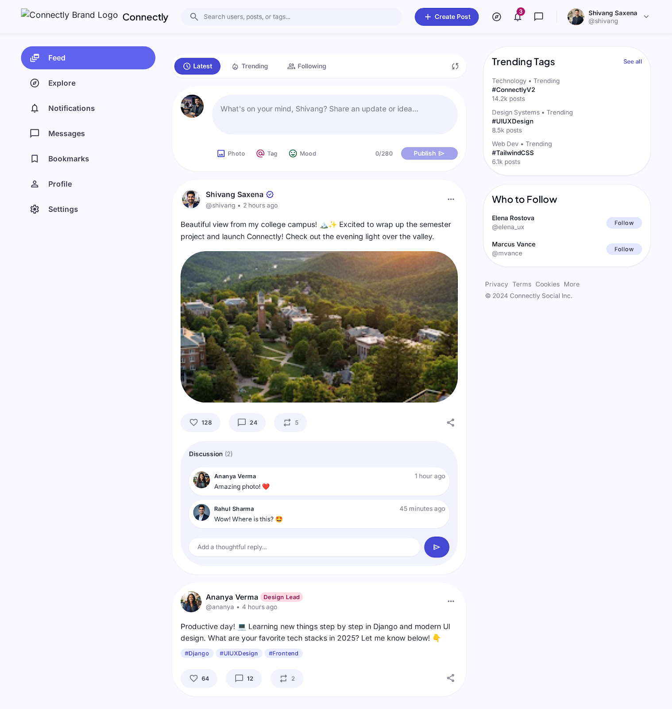

# Connectly — Mini Social Media Platform

<p align="center">
  
</p>

<p align="center">
  <strong>Share · Connect · Grow</strong><br>
  A modern, responsive, and scalable mini social media platform built with <strong>Django</strong>, <strong>Tailwind CSS</strong>, and <strong>JavaScript</strong>.
</p>

<p align="center">
  
  
  
  
  
  
</p>

---

## 📖 Table of Contents

- [Overview](#-overview)
- [Infographics & Architecture](#-infographics--architecture)
- [Key Features](#-key-features)
- [Tech Stack](#-tech-stack)
- [Project Directory Structure](#-project-directory-structure)
- [Quickstart & Installation](#-quickstart--installation)
- [Demo Accounts](#-demo-accounts)
- [Running Automated Tests](#-running-automated-tests)
- [API & URL Endpoints](#-api--url-endpoints)
- [Documentation Index](#-documentation-index)
- [License](#-license)

---

## 🌟 Overview

**Connectly** is designed to provide an expressive, distraction-free space for creators, students, and developers to share updates, engage in discussions, and build close-knit communities.

Built on the **Vibrant Connection** design system, Connectly pairs the dependability of Django's Model-View-Template architecture with tactile, pill-styled UI components, smooth client-side AJAX updates, and an optimized normalized relational schema.

---

## 📊 Infographics & Architecture

The repository includes complete architecture diagrams, blueprints, and engineering documentation:

### 1. Implementation Roadmap
Full 7-day development roadmap from project setup to testing, documentation, and deployment.
<p align="center">
  
</p>

### 2. Backend Database Schema & ER Model
Normalized database design covering User, Profile, Post, Comment, Like, Follow, and Notification models with integrity constraints.
<p align="center">
  
</p>

### 3. UI/UX Design Brief
Color palette (Electric Indigo, Vivid Pink, Emerald Accent), typography (Plus Jakarta Sans & Inter), and component guidelines.
<p align="center">
  
</p>

### 4. Application Flowchart
User journeys covering Registration, Feeds, Post Interactions, and Follow workflows.
<p align="center">
  
</p>

### 5. Product Requirements Document (PRD)
Product vision, target personas, MVP features, and success metrics.
<p align="center">
  
</p>

### 6. Technical Requirements Document (TRD)
High-level system architecture, security considerations, and query optimizations.
<p align="center">
  
</p>

---

## ✨ Key Features

- **👤 User Management & Profiles**
  - Registration with duplicate email prevention and password verification.
  - Auto-generated Profile records via Django post-save signals.
  - Editable profiles with custom avatars, bios, location, and website links.
  - Profile statistics tracking post count, follower count, and following count.

- **📝 Post Management**
  - Create posts with rich text and optional image uploads.
  - In-feed quick composer and modal dialog with live image preview.
  - Post owner controls: edit post content and soft-delete (`is_deleted=True`).
  - Dedicated post detail pages with threaded comments.

- **❤️ Likes & Reactions**
  - Instant like/unlike toggling via asynchronous AJAX requests (no page refreshes).
  - Tactile heart pulse micro-animations and live count updates.
  - Database unique constraints preventing duplicate likes.

- **💬 Comments System**
  - Real-time comment submission via AJAX with immediate DOM insertion.
  - Author and post-owner deletion permissions.

- **🤝 Follow System & Dual Feeds**
  - Follow/unfollow users with instantaneous count updates.
  - Database check constraints preventing self-following.
  - **For You Feed:** Global community timeline.
  - **Following Feed:** Curated timeline strictly featuring followed creators.

- **🔍 Explore & Discovery**
  - Explore page with category filters (Tech, Design, Photography, Community).
  - Search engine for discovering people and posts.
  - Featured creator recommendations with one-click follow buttons.

- **🔔 Activity Notifications**
  - In-app notification center tracking likes, comments, and new followers.

---

## 🛠 Tech Stack

| Layer | Technology | Description |
|---|---|---|
| **Backend** | Python 3.14+, Django 6.1 | MVC/MVT architecture, ORM, authentication |
| **Database** | SQLite (Dev) / PostgreSQL (Prod) | Normalized relational models with foreign keys & compound indexes |
| **Frontend** | HTML5, Tailwind CSS | Responsive utility-first styling with custom theme palette |
| **Typography** | Plus Jakarta Sans & Inter | Modern rounded headings and crisp body text |
| **Icons** | Material Symbols Outlined | Clean Google iconography |
| **Scripting** | Vanilla JavaScript (ES6+) | Asynchronous Fetch API, CSRF tokens, dynamic DOM manipulation |
| **Media** | Pillow (PIL) | Image verification, uploads, and format handling |

---

## 📁 Project Directory Structure

```
Connectly- Social Media Plateform/
├── connectly/                   # Django Project Root
│   ├── __init__.py
│   ├── settings.py              # Environment settings, templates, static/media configuration
│   ├── urls.py                  # Global route dispatcher
│   ├── wsgi.py
│   └── asgi.py
├── social/                      # Core Social Application
│   ├── __init__.py
│   ├── admin.py                 # Customized Django admin with soft-delete actions
│   ├── apps.py                  # App configuration & signal registration
│   ├── forms.py                 # Registration, Profile, Post, and Comment forms
│   ├── models.py                # User, Profile, Post, Comment, Like, Follow, Notification
│   ├── signals.py               # Post-save signals for Profile creation & notifications
│   ├── urls.py                  # Application URL routing
│   ├── views.py                 # View controllers & AJAX handlers
│   ├── tests.py                 # Unit & integration test suites
│   └── migrations/              # Database migration files
├── templates/                   # Clean, modular Django templates
│   ├── base.html                # Master layout with sidebar & bottom navigation
│   ├── registration/
│   │   ├── login.html           # Branded login screen
│   │   └── register.html        # Branded registration screen
│   └── social/
│       ├── feed.html            # Main home feed with "For You" & "Following" tabs
│       ├── explore.html         # Explore & creator discovery page
│       ├── profile.html         # Public profile with Posts, Media, and Likes tabs
│       ├── profile_edit.html    # Profile customization screen
│       ├── post_detail.html     # Post thread and comments view
│       ├── post_form.html       # Post create/edit standalone fallback
│       ├── followers_list.html  # Dedicated followers / following directory
│       ├── notifications.html   # Notification center
│       └── search_results.html  # People and post search results
├── static/
│   ├── css/style.css            # Micro-animations, scrollbar hiding, toast styles
│   ├── js/app.js                # CSRF handler, AJAX like/follow/comment managers
│   └── images/                  # Default avatars and cover placeholders
├── media/                       # Uploaded media directory
│   ├── posts/
│   └── profiles/
├── docs/                        # Complete technical documentation & assets
│   ├── images/                  # All 6 Infographics + UI screen previews
│   ├── PRD.md                   # Product Requirements Document
│   ├── TRD.md                   # Technical Requirements Document
│   ├── SCHEMA.md                # Schema & Constraint Specification
│   ├── ROADMAP.md               # 7-Day Implementation Plan
│   └── FLOWCHART.md             # Application Flowchart Documentation
├── populate_db.py               # Seed script with 5 demo accounts, posts, likes, & follows
├── manage.py                    # Django management script
├── requirements.txt             # Project dependencies
└── README.md                    # Project documentation
```

---

## 🚀 Quickstart & Installation

### 1. Clone the repository
```bash
git clone https://github.com/shivangsaxena1011/Connectly-Social-Media-Plateform.git
cd "Connectly- Social Media Plateform"
```

### 2. Set up a Virtual Environment
```bash
# On Windows
python -m venv venv
venv\Scripts\activate

# On macOS / Linux
python3 -m venv venv
source venv/bin/activate
```

### 3. Install Dependencies
```bash
pip install -r requirements.txt
```

### 4. Run Migrations
```bash
python manage.py migrate
```

### 5. Seed the Database with Realistic Demo Data
Populate demo users, profiles, sample media posts, likes, and followers:
```bash
python populate_db.py
```

### 6. Start the Development Server
```bash
python manage.py runserver
```

Open your browser and navigate to: **`http://127.0.0.1:8000/`**

---

## 👥 Demo Accounts

The database seeder automatically creates 5 realistic creator accounts (all passwords: `connectly123`):

| Username | Name | Role | Notes |
|---|---|---|---|
| **`shivang`** | Shivang Saxena | Lead Developer / Superuser | Access to Django Admin at `/admin/` |
| **`ananya`** | Ananya Sharma | Product Designer | Profile with portfolio & design posts |
| **`rahul`** | Rahul Verma | Full Stack Explorer | Tech discussions & code snippets |
| **`priya`** | Priya Patel | Landscape Photographer | Posts with photo media |
| **`alex`** | Alex Chen | Software Architect | Architecture & backend posts |

---

## 🧪 Running Automated Tests

Connectly comes with an automated test suite covering models, soft deletion, unique constraints, self-follow prevention, authentication, and AJAX endpoints:

```bash
python manage.py test
```

Expected output:
```text
Creating test database for alias 'default'...
...........
----------------------------------------------------------------------
Ran 11 tests in 0.850s

OK
Destroying test database for alias 'default'...
```

---

## 🌐 API & URL Endpoints

| URL Pattern | Method | Description |
|---|---|---|
| `/` | `GET` | Home feed ("For You" and "Following" tabs) |
| `/register/` | `GET`, `POST` | User registration |
| `/login/` | `GET`, `POST` | User authentication |
| `/logout/` | `GET`, `POST` | Session logout |
| `/explore/` | `GET` | Explore trending posts & recommended creators |
| `/profile/<username>/` | `GET` | User profile page (Posts, Media, Likes tabs) |
| `/profile/edit/` | `GET`, `POST` | Profile and account settings |
| `/profile/<username>/followers/` | `GET` | User followers directory |
| `/profile/<username>/following/` | `GET` | User following directory |
| `/follow/<username>/` | `POST` | Follow/Unfollow toggle (AJAX JSON) |
| `/post/create/` | `GET`, `POST` | Create post with optional photo |
| `/post/<id>/` | `GET` | Post thread & comments view |
| `/post/<id>/edit/` | `GET`, `POST` | Edit existing post |
| `/post/<id>/delete/` | `POST` | Soft-delete post |
| `/post/<id>/like/` | `POST` | Like/Unlike post toggle (AJAX JSON) |
| `/post/<id>/comment/` | `POST` | Add comment to post (AJAX JSON) |
| `/comment/<id>/delete/` | `POST` | Delete comment |
| `/notifications/` | `GET` | View user notifications |
| `/search/` | `GET` | Search users and posts by keyword |

---

## ☁️ Deployment Guide

Connectly is pre-configured with `gunicorn`, `whitenoise`, and `dj-database-url` for instant production deployment:

### Option 1: Render (Recommended — Free / Zero-Config)
1. Fork or push your code to your GitHub account: `https://github.com/shivangsaxena1011/Connectly-Social-Media-Plateform`.
2. Go to [Render Dashboard](https://dashboard.render.com/) and click **New + > Web Service**.
3. Connect your GitHub repository: `Connectly-Social-Media-Plateform`.
4. Configure settings:
   - **Environment:** `Python 3`
   - **Build Command:** `./build.sh`
   - **Start Command:** `gunicorn connectly.wsgi:application`
5. Under **Advanced > Add Environment Variable**:
   - `DJANGO_DEBUG` = `False`
   - `DJANGO_SECRET_KEY` = `<click Generate>`
   - `PYTHON_VERSION` = `3.12.0`
6. Click **Create Web Service**. Render will automatically run the build script, collect static files, apply migrations, seed demo accounts, and launch your live site!

### Option 2: Railway
1. Go to [Railway.app](https://railway.app/) and create a **New Project**.
2. Select **Deploy from GitHub repo** and pick `Connectly-Social-Media-Plateform`.
3. Add a **PostgreSQL Database** service to the project. Railway automatically exposes `DATABASE_URL`, which Connectly automatically binds to!
4. Under project settings, set `DJANGO_DEBUG` = `False`.
5. Railway uses the included `Procfile` to start the app automatically.

### Option 3: PythonAnywhere
1. Create a free account at [PythonAnywhere.com](https://www.pythonanywhere.com/).
2. Open a **Bash Console** and clone the repository:
   ```bash
   git clone https://github.com/shivangsaxena1011/Connectly-Social-Media-Plateform.git
   ```
3. Set up a virtual environment and install `requirements.txt`.
4. In the **Web** tab:
   - Point the Source Code directory to the project folder.
   - Set up the WSGI file to load `connectly.wsgi`.
   - Map `/static/` to `c:/.../staticfiles/` and `/media/` to `c:/.../media/`.
5. Reload the web app.

---

## 📚 Documentation Index

- [Product Requirements Document (PRD)](docs/PRD.md)
- [Technical Requirements Document (TRD)](docs/TRD.md)
- [7-Day Implementation Roadmap](docs/ROADMAP.md)
- [Application Flowchart](docs/FLOWCHART.md)

---

## 📄 License

This project is licensed under the MIT License — see the [LICENSE](LICENSE) file for details.
